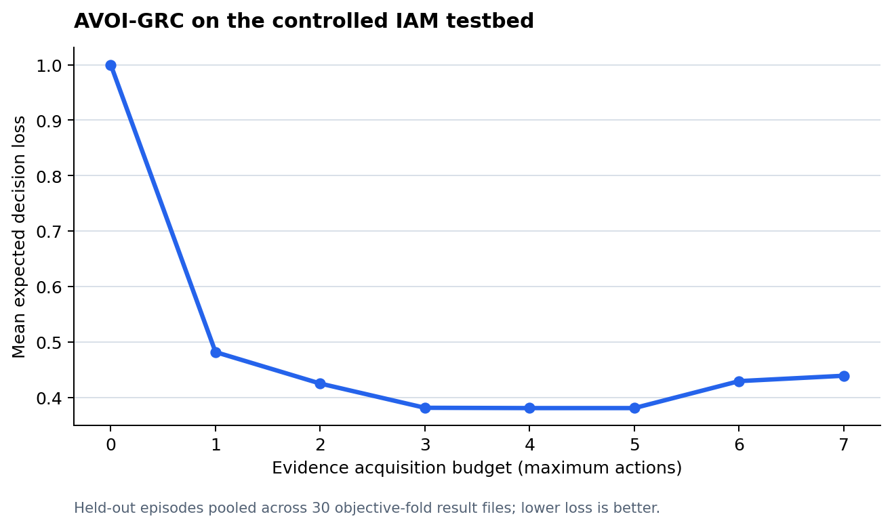

# AVOI: Value-of-Information-Guided Evidence Acquisition for Cybersecurity Assurance

AVOI is a research prototype for deciding which cybersecurity assurance evidence to acquire next. It models assurance as a sequential decision problem and balances expected decision risk against acquisition cost, privacy exposure, and delay, with asymmetric false-assurance losses and human escalation.

This repository supports experiments and reproducible research. Its public-dataset results are replay validations on observable security-assurance micro-claims; they are not compliance decisions or certifications. Testbed predicates are experimental operationalisations inspired by NIST SP 800-53/53A, NCA ECC-2:2024, and SCF.

## Reuse the code

### Requirements

- Windows 11 with PowerShell 5.1+ or Linux/macOS with Bash
- Python 3.11 or newer
- Docker Desktop with Compose for the controlled IAM testbed
- Internet access and sufficient storage for the public dataset downloads (AIT and CERT downloads total about 22 GB)

The repository does not redistribute raw datasets. Follow [`docs/DATASETS.md`](docs/DATASETS.md) for source links, access limitations, and licensing. Some sources require accepting terms or requesting access before downloading. Do not treat the generated micro-claims as compliance findings.

### Reproduce the pipeline

Clone the repository, then run the provided script from its root. It creates a virtual environment, installs the pinned dependencies, downloads and processes data, runs experiments, and regenerates tables, figures, and reports.

```powershell
git clone https://github.com/amakremi/AVOI-Value-of-Information-Guided-Evidence-Acquisition-for-Cybersecurity-Assurance.git
cd AVOI-Value-of-Information-Guided-Evidence-Acquisition-for-Cybersecurity-Assurance
.\reproduce.ps1
```

The complete pipeline also starts the Docker testbed and can take several hours. To omit the optional Ollama-based LLM planner, use:

```powershell
.\reproduce.ps1 -SkipLLM
```

After datasets and processed stores are already available, rerun the experiments and analysis without rebuilding those inputs:

```powershell
.\reproduce.ps1 -SkipDownload -SkipTestbed -SkipPublicBuild -SkipLLM
```

On Linux/macOS, use `./reproduce.sh`. Set `SKIP_DOWNLOAD=1`, `SKIP_TESTBED=1`, or `SKIP_LLM=1` to omit those stages. The shell script currently always rebuilds public processed datasets and runs all experiments; use the PowerShell script for the full set of skip controls.

### Run a focused experiment

For code changes or smaller runs, create the locked environment and set the source path:

```powershell
python -m venv .venv
.\.venv\Scripts\python.exe -m pip install -r requirements.lock.txt
$env:PYTHONPATH = "src"
```

Then run an experiment entry point, for example:

```powershell
.\.venv\Scripts\python.exe experiments\run_primary.py --workers 4
```

Experiment runners and their inputs are under [`experiments/`](experiments/), [`config/`](config/), and [`src/avoi/`](src/avoi/). See [`docs/REPRODUCIBILITY.md`](docs/REPRODUCIBILITY.md) for seeds, frozen-input hashes, output locations, and platform notes. See [`docs/METHODOLOGY.md`](docs/METHODOLOGY.md), [`docs/LEAKAGE_CONTROLS.md`](docs/LEAKAGE_CONTROLS.md), and [`docs/LIMITATIONS.md`](docs/LIMITATIONS.md) before interpreting or extending results.

Run the test suite with:

```powershell
.\.venv\Scripts\python.exe -m pytest tests -q -p no:cacheprovider
```

Generated episode-level outputs and large processed stores are ignored by Git and must be regenerated locally. The checked-in reports, tables, manifests, and this one summary curve provide the published snapshot; regenerating that snapshot requires the inputs and experiments described above.

## One results curve

This single curve shows mean expected decision loss across the controlled IAM testbed's held-out episodes as the evidence-acquisition budget increases. It is an illustrative summary of the AVOI-GRC policy, not a comparison against every baseline. The full analysis, including caveats and statistical results, is in [`results/final_report/RESULTS.md`](results/final_report/RESULTS.md).



## Repository map

- `src/avoi/` — agent, decision and evidence models, datasets, evaluation, and reporting
- `experiments/` — experiment and report entry points
- `config/` — objectives, actions, losses, and experiment settings
- `testbed/` and `docker-compose.yml` — controlled IAM environment
- `data/` — dataset downloaders, manifests, and processed inputs
- `results/` — reports, tables, manifests, and figures
- `docs/` — methodology, data provenance, limitations, and reproduction details
